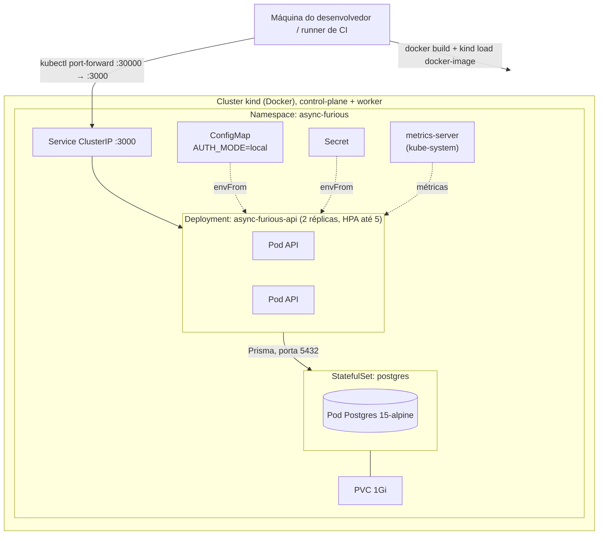

# Diagrama de Implantação (Deployment)

> Notação UML de implantação, expressa em Mermaid. Dois ambientes: o local,
> via `kind`, e o de nuvem, em EKS. **Na Fase 4 o ambiente de nuvem dos três
> microsserviços é só o `hml`** ([`edge-topology.md`](./edge-topology.md) §5):
> o `prod` segue com o monólito da Fase 3 e não é alterado.
>
> **Versão preliminar (02/11/2026)** da topologia da Fase 4, derivada das ADRs
> ([ADR-0020](../adr/0020-bancos-compartilhados-isolamento-credencial.md),
> [ADR-0021](../adr/0021-borda-sem-bff.md), [ADR-0018](../adr/0018-mensageria-contratos-eventos.md),
> [ADR-0019](../adr/0019-documentdb-read-model-os-cliente.md)); revisão de
> fechamento depois de 08/11/2026 (Feature
> [#348](https://github.com/Async-And-Furious/async-furious-project/issues/348)).
> A visão lógica (serviços, tópicos, dados, borda) está no diagrama-mestre de
> [overview.md](./overview.md); este documento mostra **onde cada artefato roda**.
>
> Detalhamento dos recursos em [aws.md](../infrastructure/aws.md),
> [kubernetes.md](../infrastructure/kubernetes.md) e
> [api-gateway-lambda.md](../infrastructure/api-gateway-lambda.md).

## 1. Ambiente local (kind + Terraform)

Continua sendo o do OS Service (`async-furious-project`): um único serviço e um
PostgreSQL no cluster. Os serviços novos (Billing e Execução) rodam localmente
com `pnpm start` e o PostgreSQL do `docker-compose.dependencies.yml` do próprio repositório.

Evidência: `infra/environments/local/`, `infra/modules/kubernetes-apps/`,
`k8s/*.yaml`, `scripts/local-up.sh`.

- **Registry**: nenhum. A imagem `async-furious-api:local` é construída
  localmente e carregada nos nós com `kind load docker-image`, necessário a
  cada mudança de código porque `imagePullPolicy` é `IfNotPresent`.
- **Banco**: dentro do cluster, controlado pela variável
  `enable_local_database`. Desligada, o módulo aceita uma `database_url`
  externa.
- **Probes**: readiness em `/api/v1/health/ready`, liveness e startup em
  `/api/v1/health/live`.
- **Acesso**: `kubectl port-forward`, não NodePort.
- **Autenticação**: `AUTH_MODE=local`, com login por e-mail e senha dentro do
  próprio NestJS.
- **CI**: `terraform.yml` sobe um cluster `kind` efêmero no runner, aplica,
  inspeciona e descarta. Nunca toca nuvem persistente.

## 2. Ambiente AWS — Fase 4 (hml)

Evidência: `repo-k8s-infra` (`modules/alb`, `modules/ecr`, `main.tf`,
`kafka-values.yaml`), `repo-db-infra` (`modules/rds`, `modules/docdb-read-model`,
`modules/service-secrets`), `repo-auth-serverless` (`infra/hml`) e os `k8s/` de
cada serviço.

```mermaid
flowchart TB
    client["Cliente HTTP"]
    mp["Mercado Pago"]
    runner["GitHub Actions runner<br/>um pipeline por repositório"]

    subgraph AWS["AWS, conta única, ambiente hml"]
        subgraph Edge["repo-auth-serverless"]
            apigw["API Gateway HTTP API<br/>tc3-auth-hml"]
            lambdaAuth["Lambda authenticate-customer<br/>na VPC"]
            lambdaAuthz["Lambda authorize-request<br/>fora da VPC"]
            keys[("Secrets Manager e SSM<br/>chaves RS256")]
        end

        subgraph VPC["VPC tc3-vpc-hml (10.0.0.0/16), dona: repo-k8s-infra"]
            subgraph Priv["Subnets privadas (2 AZs)"]
                alb["ALB interno tc3-hml-internal :80<br/>default_action para o OS Service<br/>regras por path_pattern"]
                tgOs["Target group tc3-hml-app<br/>(OS Service)"]
                tgBill["Target group tc3-hml-billing"]
                tgExec["Target group tc3-hml-execucao"]

                subgraph EKS["EKS tc3-eks-hml, endpoint privado, nós t3.medium SPOT"]
                    subgraph nsOs["namespace async-furious"]
                        podsOs["Pods OS Service<br/>HPA 2 a 5"]
                        cron["CronJob detector de OS parada<br/>(alvo, saga-flow §3)"]
                        migOs["Job de migração<br/>prisma migrate deploy"]
                        tgbOs["TargetGroupBinding"]
                    end
                    subgraph nsBill["namespace billing"]
                        podsBill["Pods Billing Service"]
                        migBill["Job billing-migrate"]
                        tgbBill["TargetGroupBinding"]
                    end
                    subgraph nsExec["namespace execucao"]
                        podsExec["Pods Execução e Produção"]
                        migExec["Job de migração"]
                        tgbExec["TargetGroupBinding"]
                    end
                    subgraph nsKafka["namespace kafka"]
                        kafka["Kafka KRaft (chart Bitnami, Helm)<br/>SASL, PVC EBS gp3<br/>tópicos criados por Job"]
                    end
                    nrb["New Relic bundle<br/>infra, logs, kube-state-metrics"]
                end

                rds[("RDS PostgreSQL 16<br/>tc3-db-hml, uma instância<br/>bancos os_service, billing, execucao_producao")]
                ddb[("DocumentDB tc3-docdb-hml<br/>1 instância, TLS, porta 27017<br/>banco os_read_model")]
            end
        end

        ecr["ECR tc3-os-hml, tc3-billing-hml e tc3-execucao-hml<br/>tags imutáveis, um repositório por serviço"]
        sm[("Secrets Manager<br/>tc3-db-os, tc3-db-billing, tc3-db-execucao,<br/>tc3-docdb-os, tc3/kafka")]
        s3[("S3 tc3-tfstate<br/>estado Terraform")]
        cw["CloudWatch<br/>logs das Lambdas e alarmes"]
    end

    nr["New Relic<br/>APM, traces, dashboard e alertas"]

    client -->|"HTTPS"| apigw
    mp -->|"webhook HTTPS, rota sem authorizer"| apigw
    apigw -->|AWS_PROXY| lambdaAuth
    apigw -->|authorizer REQUEST| lambdaAuthz
    lambdaAuth --> keys
    lambdaAuthz --> keys
    lambdaAuth -->|"SELECT em Cliente"| rds
    apigw -->|"HTTP_PROXY via VPC Link"| alb

    alb --> tgOs --> podsOs
    alb -->|"orcamentos*, pagamentos*, webhooks/mercado-pago"| tgBill --> podsBill
    alb -->|"execucoes*"| tgExec --> podsExec
    tgbOs -.registra IPs.-> tgOs
    tgbBill -.registra IPs.-> tgBill
    tgbExec -.registra IPs.-> tgExec

    podsOs -->|"Prisma, TLS"| rds
    podsBill -->|"Prisma, TLS"| rds
    podsExec -->|"Prisma, TLS"| rds
    migOs --> rds
    migBill --> rds
    migExec --> rds
    podsOs -->|"driver mongodb, TLS"| ddb
    podsOs -->|"produtor e consumidor"| kafka
    podsBill -->|"produtor e consumidor"| kafka
    podsExec -->|"produtor e consumidor"| kafka
    podsBill -->|"cria preference, reconsulta"| mp

    ecr -.pull por digest.-> podsOs
    ecr -.pull por digest.-> podsBill
    ecr -.pull por digest.-> podsExec
    sm -.credenciais.-> podsOs
    sm -.credenciais.-> podsBill
    sm -.credenciais.-> podsExec

    runner -->|"docker push por SHA"| ecr
    runner -->|"lê outputs"| s3
    runner -->|"kubectl, janela /32 temporária"| EKS

    lambdaAuth -.-> cw
    lambdaAuthz -.-> cw
    rds -.-> cw
    podsOs -.APM.-> nr
    podsBill -.APM.-> nr
    podsExec -.APM.-> nr
    nrb -.métricas e logs.-> nr
```

Seta contínua é chamada síncrona ou conexão de dados; seta pontilhada é
registro, entrega de artefato, credencial ou telemetria. Os eventos entre
serviços passam pelo Kafka e estão detalhados em [overview.md](./overview.md) e
[`event-catalog.md`](./event-catalog.md).

### O que muda em relação à Fase 3

| Aspecto | Fase 3 (monólito, hml e prod) | Fase 4 (hml) |
|---|---|---|
| Serviços no cluster | Um (`async-furious-api`, namespace `async-furious`) | Três, em namespaces `async-furious`, `billing` e `execucao`, mais `kafka` |
| ALB | Um target group (`tc3-<env>-app`) | Um target group por serviço e regras `path_pattern` por recurso; o OS Service segue como `default_action` |
| ECR | `tc3-app-<env>` | Um repositório por serviço: `tc3-os-`, `tc3-billing-` e `tc3-execucao-<env>` |
| RDS | Um banco lógico (`workshop`) | Três bancos lógicos (`os_service`, `billing`, `execucao_producao`), uma credencial por serviço |
| NoSQL | Nenhum | DocumentDB do OS Service (`os_read_model`) |
| Mensageria | Eventos in-process (ADR-0009) | Kafka no cluster (KRaft), um tópico `*.eventos.v1` por serviço produtor, com `retry` e `dlt` |
| Borda | `POST /auth` e `ANY /{proxy+}` | Mais rotas públicas específicas sem authorizer (status, aprovar/recusar orçamento, webhook do Mercado Pago) |
| Pods e nós | HPA de 2 a 5, nós SPOT em hml e ON_DEMAND em prod | Mesmo cluster compartilhado e mesmo tipo de nó; capacidade dimensionada para os três serviços e o Kafka (Feature #313) |

### Limites de rede

- **API Gateway** é o único componente público. Nem ALB, nem cluster, nem pods
  são alcançáveis diretamente da internet.
- **ALB é interno** e seu security group só aceita tráfego do CIDR da própria
  VPC. Ele nunca é internet-facing.
- **Endpoint da API do Kubernetes é privado** por padrão. O pipeline abre uma
  janela temporária apenas para o IP do runner, com máscara `/32`, e restaura a
  configuração original em passo `if: always()`.
- **RDS e DocumentDB são privados**: ficam nas subnets privadas publicadas por
  `repo-k8s-infra`, sem acesso público. O DocumentDB só aceita a porta 27017 de
  security groups ou CIDRs aprovados. A [RFC-007](../rfcs/RFC-007-rds-public-access.md),
  que propunha RDS público em HML, está superada.
- **Sem `NetworkPolicy`** (Feature #313): não há isolamento de rede entre pods;
  o isolamento entre serviços é por credencial de banco (ADR-0020) e pela
  validação local do JWT (ADR-0021).
- **Kafka só dentro do cluster**, com autenticação SASL; as credenciais vêm do
  segredo `tc3/kafka/<env>` do Secrets Manager.
- **Ordem de provisionamento é obrigatória**: `repo-db-infra` lê o estado de
  `repo-k8s-infra` para descobrir VPC, subnets e security group dos nós
  ([RFC-004](../rfcs/RFC-004-vpc-ownership.md)).

### Protocolos

| Trecho | Protocolo |
|---|---|
| Cliente e Mercado Pago (webhook) → API Gateway | HTTPS |
| API Gateway → Lambdas | invocação Lambda (`AWS_PROXY`, payload 2.0) |
| API Gateway → ALB | HTTP via VPC Link (`HTTP_PROXY`, payload 1.0) |
| ALB → Pods | HTTP na porta 3000, alvos registrados por IP |
| Serviços e Lambda → RDS | PostgreSQL, TLS obrigatório (`rds.force_ssl=1`) |
| OS Service → DocumentDB | driver `mongodb`, TLS, porta 27017 |
| Serviços → Kafka | protocolo Kafka (`kafkajs`) com SASL, dentro do cluster |
| Billing → Mercado Pago | HTTPS (SDK oficial, timeout de 5 s e 1 retry) |
| Lambdas → Secrets Manager e SSM | HTTPS, escopo IAM |
| Runner → ECR e EKS | HTTPS, credenciais de usuário IAM da conta pessoal |

### Diferenças entre hml e prod

| Aspecto | hml | prod |
|---|---|---|
| Serviços implantados | Os três (Fase 4) | Só o monólito da Fase 3 |
| Ingresso no RDS (privado nos dois) | CIDRs explícitos | só security group |
| Multi-AZ | não | sim |
| Retenção de backup | 1 dia | 1 dia |
| Proteção de deleção | não | sim |
| Nós do EKS | SPOT | ON_DEMAND |
| Seed | só em disparo manual (no OS Service, `seed_customer` ou `seed_comprehensive`; nos novos, seed de HML descrito no README de cada serviço) | só em disparo manual, com `seed_prod`, `seed_customer` ou `seed_comprehensive` |
| Gatilho de deploy | push em `develop` | push em `main`, ou manual a partir de `main` |
| Remoção | apaga o namespace | apaga apenas os recursos criados pelo deploy |

### Pendências deste diagrama

- **TLS interno**: o ALB serve HTTP na porta 80, sem certificado. O TLS termina
  no API Gateway. Exceção registrada com `#trivy:ignore:AWS-0054` no código de
  `repo-k8s-infra`, por não haver ACM nem domínio contratado.
- **Alarmes CloudWatch sem destino na borda**: os alarmes de
  `repo-auth-serverless` usam `alarm_actions = []`; os do RDS dependem dos
  secrets `*_ALARM_ACTIONS` do pipeline. A notificação por e-mail existe apenas
  nos alertas da New Relic, que cobrem aplicação e cluster.
- **Rotas da borda**: as rotas sem authorizer (status, aprovar/recusar
  orçamento e webhook do Mercado Pago) ainda não existem em
  `repo-auth-serverless` (`infra/hml`): hoje só `POST /auth`, o health público e
  as rotas autenticadas do desenho anterior à revisão de 30/09
  (`ANY /api/v1/{proxy+}`, `/billing/{proxy+}` e `/execucao/{proxy+}`), a
  substituir pela `ANY /{proxy+}` da ADR-0021.
- **Billing e Execução ainda sem entrega no cluster**: seus repositórios não têm
  `TargetGroupBinding` nem workflow de build, push no ECR e deploy (o Billing só
  tem `ci.yml`); o diagrama mostra o alvo.
- **Kafka e EBS**: o volume EBS do broker fica preso a uma AZ; se o nó SPOT dela
  for reciclado, o pod pode ficar sem nó elegível (risco aceito na ADR-0018).
- **Sem pipeline de PROD para os serviços novos**: decisão da Fase 4
  (HML-only); não há workflow de deploy para PROD.
