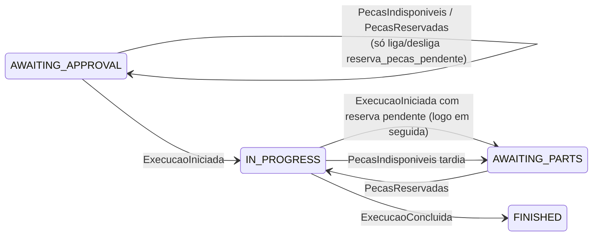

# Integração do OS Service com o Execução e Produção (Feature #334)

> Descreve como o OS Service (este repositório) se relaciona com o serviço de
> Execução e Produção depois que as rotas do mecânico `assumir`, `analisar` e
> `finalizar-execucao` saíram daqui (Feature #334, Epic #333). O fluxo
> distribuído e a divisão de responsabilidades são os de
> [`saga-flow.md`](./saga-flow.md) §2 (fonte única) e de
> [ADR-0017](../adr/0017-divisao-microsservicos-ownership-dados.md); o contrato
> dos eventos está em [`event-catalog.md`](./event-catalog.md) e na
> [ADR-0018](../adr/0018-mensageria-contratos-eventos.md). Este documento só
> registra o que o **código do OS Service** faz hoje: rotas, consumidores,
> guardas, idempotência, a condição de merge e o comportamento transitório.

## 1. Rotas do mecânico

| Rota (OS Service) | Situação | Onde passa a viver |
|---|---|---|
| `PATCH /api/v1/ordens-servico/:id/assumir` | removida | `PATCH /api/v1/execucoes/{id}/iniciar-diagnostico` (Execução) |
| `PATCH /api/v1/ordens-servico/:id/analisar` | removida | mesma rota `iniciar-diagnostico`; sem contrapartida no OS |
| `PATCH /api/v1/ordens-servico/:id/finalizar-execucao` | removida | `PATCH /api/v1/execucoes/{id}/concluir` (Execução) |
| `PATCH /api/v1/ordens-servico/:id/servicos-insumos` | **mantida** | continua no OS Service (depende de `Servico` e `Peca`) |

`servicos-insumos` mudou em dois pontos: exige a OS em `UNDER_DIAGNOSIS`
(`400` se `DiagnosticoIniciado` ainda não foi processado; o mecânico repete) e
responde `200` com os **totais calculados**, não mais com o `Orcamento`:

```json
{
  "ordemServicoId": "3fa85f64-5717-4562-b3fc-2c963f66afa6",
  "valorTotalServicos": 450,
  "valorTotalPecas": 320.5,
  "valorTotalGeral": 770.5
}
```

O orçamento passa a ser consultado no Billing
(`GET /api/v1/orcamentos/{ordemServicoId}`). Os totais são calculados com
`Decimal` (`OrcamentoVo`) e só convertidos para `number` na borda do evento e da
resposta, o mesmo formato do exemplo de `OrcamentoCalculado` na ADR-0018.
Valores negativos são rejeitados antes de qualquer gravação em `OsPeca`.

Os casos de uso `AssumirOrdemServicoUseCase`, `AnalisarVeiculoUseCase` e
`FinalizarExecucaoUseCase`, os guards de domínio `podeAssumir`,
`podeAnalisarVeiculo` e `podeFinalizar` e os eventos internos
`OrdemServicoAssumida`, `VeiculoAnalisado` e `ServicoConcluidoPeloMecanico`
foram removidos. `ServicosEInsumosListados` foi renomeado para
`OrcamentoCalculado` (agora com `valorTotalGeral`).

## 2. Eventos publicados pelo OS Service

| Evento | Quando | Consumidor |
|---|---|---|
| `OrdemServicoRecebida` | `POST /ordens-servico`, logo depois de `OrdemServicoCriada` | Execução e Produção (cria a `Execucao` na fila de diagnóstico) |
| `OrcamentoCalculado` | `servicos-insumos` bem-sucedido | Billing Service; hoje, `GerarOrcamentoHandler` (ver §5) |
| `EtapaDaSagaFalhou` (`etapa=reparo`) | `ExecucaoConcluida` com a OS em `AWAITING_PARTS` | só registro e alerta; sem compensação automática (ADR-0018) |

Enquanto não há produtor Kafka, os três saem pelo `EmissorEventos` in-process
([ADR-0009](../adr/0009-eventos-dominio-in-process.md)), com o mesmo nome do
evento de integração. `OrdemServicoRecebida` e `EtapaDaSagaFalhou` ainda não
têm ouvinte in-process: esperam o publicador de integração. O payload de
`EtapaDaSagaFalhou` segue a ADR-0018 (`servicoOrigem`, `eventTypeOriginal`,
`ordemServicoId`, `etapa`, `motivo`).

**Exceção a ADR-0018 em `eventTypeOriginal`.** A ADR define `eventTypeOriginal`
como o `eventType` da mensagem que foi para a dead-letter topic. O caso de
`ExecucaoConcluida` com a OS em `AWAITING_PARTS` não passa por retry nem por DLT:
é uma regra de negócio (o reparo terminou sem a peça). Aqui o campo recebe o
`eventType` do evento que disparou a regra (`ExecucaoConcluida`), e
`servicoOrigem` é `os-service`. Assim o consumidor do `EtapaDaSagaFalhou` recebe o
mesmo payload nos dois casos. Essa exceção vale até a ADR-0018 decidir se a falha
de negócio também deve sair como `EtapaDaSagaFalhou`, já que ela define o evento
como falha técnica.

## 3. Eventos do Execução consumidos pelo OS Service

| Evento | Handler | Guarda | Efeito | Se a guarda falhar |
|---|---|---|---|---|
| `DiagnosticoIniciado` | `AtualizarStatusEmDiagnosticoHandler` | OS em `RECEIVED` | grava `UNDER_DIAGNOSIS`, emite `OrdemServicoEmDiagnostico` (notifica o cliente) | ack, log informativo (reentrega ou OS já além) |
| `ExecucaoIniciada` | `AtualizarStatusExecucaoIniciadaHandler` | OS em `AWAITING_APPROVAL` (ou `IN_PROGRESS` com `reserva_pecas_pendente`, retomada) | grava `IN_PROGRESS` condicionado a `AWAITING_APPROVAL` (se não casar, relê a OS e segue pelo estado atual) e emite `OrdemServicoEmExecucao` (marca `iniciada_em`); se `reserva_pecas_pendente`, grava em seguida `AWAITING_PARTS`. Na reentrega com a OS em `IN_PROGRESS` sem `iniciada_em`, emite `OrdemServicoEmExecucao` de novo | **falha retentável** se a OS está em `RECEIVED` ou `UNDER_DIAGNOSIS` (nada gravado); ack, log informativo nos demais estados (`IN_PROGRESS` sem pendência, `AWAITING_PARTS`, `FINISHED`, `DELIVERED`, `CLOSED_WITHOUT_EXECUTION`) |
| `ExecucaoConcluida` | `AtualizarStatusFinalizadaHandler` | OS em `IN_PROGRESS` | grava `FINISHED` e emite `OrdemServicoFinalizada` (tempo médio e notificação de conclusão seguem como estavam) | em `AWAITING_PARTS`: emite `EtapaDaSagaFalhou` (`reparo`) e registra o motivo em `HistoricoStatusOS`, uma vez só (reentrega com a linha já gravada: só log); em `RECEIVED`, `UNDER_DIAGNOSIS` ou `AWAITING_APPROVAL`: **falha retentável**; em `FINISHED`, `DELIVERED`, `CLOSED_WITHOUT_EXECUTION`: ack, log informativo |

As transições são validadas por `StatusTransitionService.validarTransicao`, a
mesma tabela usada pelo `PATCH .../status`, antes de cada gravação.

**Evento fora de ordem.** Quando o estado atual está **antes** do esperado (o
evento anterior ainda não chegou), o handler lança `FalhaRetentavelException`
(`src/shared/domain/exceptions/falha-retentavel.exception.ts`). É a exceção que o
consumidor Kafka deve reconhecer como retentável: a entrega entra no ciclo de
retry da ADR-0018 (3 tentativas, depois a DLT) e nada é gravado. Quando o estado
já passou do esperado (reentrega, evento obsoleto, OS em estado terminal), o
handler reconhece a entrega (ack) com log, e isso é a idempotência do consumidor.

**Limite in-process.** Hoje o `EmissorEventos` usa o `EventEmitter2` com o padrão
do `@nestjs/event-emitter` (`suppressErrors: true`): o erro do listener é
registrado em log pelo Nest e não sai do `emitAsync`. Até o consumidor Kafka
existir, a falha retentável não é retentada; ela só não grava. O consumidor Kafka
tem de receber a rejeição do handler, sem passar pelo wrapper que a suprime.

**Desvio do critério de ack em `ExecucaoIniciada`.** O critério original manda
ack, com log, para `ExecucaoIniciada` com a OS além de `AWAITING_APPROVAL`. Em
`IN_PROGRESS` o handler não só faz ack: ele retoma. Se a reserva de peças está
pendente, leva a OS a `AWAITING_PARTS` (a segunda gravação da seção acima). Se
`iniciada_em` está nulo, reemite `OrdemServicoEmExecucao`. Motivo: uma reentrega
precisa poder completar o que a entrega anterior não terminou. O ack vale para
`AWAITING_PARTS`, `FINISHED`, `DELIVERED` e `CLOSED_WITHOUT_EXECUTION`, como na
tabela.

## 4. A reserva de peças deixou de mudar o status na aprovação

Pela [`saga-flow.md`](./saga-flow.md) §2, a OS só vai a `IN_PROGRESS` quando o
mecânico inicia o reparo (`ExecucaoIniciada`). Por isso:

- `PecasIndisponiveis` (`AtualizarStatusAguardandoPecasHandler`):
  - com a OS em `AWAITING_APPROVAL`, liga `OrdemServico.reserva_pecas_pendente`
    com gravação condicionada a `status = AWAITING_APPROVAL` (`atualizarSeCondicao`).
    Se `ExecucaoIniciada` levar a OS a `IN_PROGRESS` entre a leitura e essa
    gravação, a pendência não entra: o handler relê a OS e segue o ramo de
    `IN_PROGRESS` abaixo, sem deixar `IN_PROGRESS` com a pendência ligada;
  - com a OS em `IN_PROGRESS` (**reserva tardia**: `ExecucaoIniciada` foi
    processado antes da reserva, porque eventos de tópicos diferentes não têm
    ordem entre si), grava `reserva_pecas_pendente = true` e depois leva a
    `AWAITING_PARTS`, condicionado a status `IN_PROGRESS` e à pendência
    (`atualizarSeCondicao`). Se `PecasReservadas` baixar a pendência antes dessa
    gravação, a condição não casa: a OS segue em `IN_PROGRESS`, sem emitir;
  - com a OS em `AWAITING_PARTS`, é reentrega: log, nada gravado.
- `PecasReservadas` (`AtualizarStatusEmExecucaoHandler`), nesta ordem:
  1. desliga `reserva_pecas_pendente` em qualquer status com reserva (a gravação
     só casa se a pendência estiver ligada);
  2. relê a OS. Se ela estiver em `AWAITING_PARTS`, tenta voltar a `IN_PROGRESS`,
     condicionado ao status no momento da gravação, e só então emite
     `OrdemServicoEmExecucao`. A leitura é feita depois do passo 1 de propósito: a
     partir daí `ExecucaoIniciada` não consegue mais gravar `AWAITING_PARTS` para
     essa reserva, então a leitura mostra o estado final.
  Com a OS em `AWAITING_APPROVAL` só a pendência muda. Com a OS em `IN_PROGRESS`,
  é reserva confirmada depois do início do reparo: log informativo.
  `OsSemPecasConfirmada` deixou de ter ouvinte.
- `OrdemServicoBacklogAdapter.findAllAguardandoPecas` passou a devolver também
  as OS em `AWAITING_APPROVAL` com `reserva_pecas_pendente = true`: elas ainda
  não receberam `ExecucaoIniciada`, mas já esperam peça e precisam ser
  liberadas quando o estoque chegar.



A ida a `AWAITING_PARTS` no `ExecucaoIniciada` não usa a leitura da OS para
decidir: a gravação só acontece com `status = IN_PROGRESS` e
`reserva_pecas_pendente = true` no momento do `UPDATE`
(`IOrdemServicoRepository.atualizarSeCondicao`). Como o `PecasReservadas` baixa a
pendência antes de tentar a volta, qualquer intercalação entre os dois eventos
termina em `IN_PROGRESS` sem pendência, ou em `AWAITING_PARTS` seguido da volta.
A OS não fica presa em `AWAITING_PARTS` sem evento que a libere.

Não existe `AWAITING_APPROVAL → AWAITING_PARTS` direto e nenhum guard de
transição mudou. A coluna é necessária porque a pendência precisa sobreviver
entre `PecasIndisponiveis` (na aprovação do orçamento) e `ExecucaoIniciada`
(depois do pagamento e da ação do mecânico), possivelmente em processos
diferentes. A coluna é aditiva: `BOOLEAN NOT NULL DEFAULT false`, migration
`20261027120000_os_reserva_pecas_pendente`.

## 5. Comportamento transitório e condição de merge

- **Nada emite os eventos do Execução enquanto o serviço não existe.** Sem
  `DiagnosticoIniciado`, a OS fica em `RECEIVED`; sem `ExecucaoIniciada`, a OS
  aprovada fica em `AWAITING_APPROVAL`; sem `ExecucaoConcluida`, não chega a
  `FINISHED`. O monólito sozinho não percorre mais o fluxo do mecânico: o
  teste e2e (`test/ordem-servico.e2e-spec.ts`) injeta os três eventos pelo
  `EventEmitter2`.
- **`GerarOrcamentoHandler` continua**, agora ouvindo `OrcamentoCalculado`: faz
  in-process o papel do Billing (persiste o `Orcamento` e emite
  `OrcamentoGerado`). Deve ser removido junto com o corte do `Orcamento` para o
  Billing, para não haver dois criadores de orçamento.
- **Condição de merge.** As rotas do mecânico só saem de `develop` quando o fluxo
  estiver ligado de ponta a ponta. A condição é o conjunto abaixo, por repositório.
  O estado descrito foi conferido no código de cada repo em 28/10; antes do merge,
  refazer a checagem contra a branch base de cada um.
  1. **Execução e Produção em HML** (#321, com a plataforma da #314):
     - publicador Kafka de `execucao.eventos.v1` (`DiagnosticoIniciado`,
       `ExecucaoIniciada`, `ExecucaoConcluida`). Hoje o publicador é o
       `LogExecucaoEventPublisher`;
     - consumidor de `os.eventos.v1` para `OrdemServicoRecebida`, que cria a
       `Execucao` na fila de diagnóstico. Hoje não existe `@OnEvent`,
       `EventPattern` nem subscriber, então nenhuma `Execucao` nasce e
       `iniciar-diagnostico` não tem o que alterar;
     - consumidor de `billing.eventos.v1` para `PagamentoConfirmado` (leva a
       `Execucao` a `AGUARDANDO_REPARO` via `liberarParaReparo()`). Hoje o método
       não tem chamador e não há consumidor;
     - consumidor de `billing.eventos.v1` para `OrcamentoRecusado` e
       `PagamentoRecusado` (cancelamento, `CANCELADA`), exigido pelo
       `event-catalog.md`;
     - as rotas `iniciar-diagnostico`, `iniciar-reparo` e `concluir` de pé.
  2. **Billing Service em HML** (#326, já citada no código do Billing):
     - publicador real de `billing.eventos.v1` (`OrcamentoGerado`,
       `OrcamentoAprovado`, `OrcamentoRecusado`, `PagamentoConfirmado`,
       `PagamentoRecusado`). Hoje o publicador é o
       `log-publicador-eventos.ts`, marcado como provisório, que só grava em log;
     - consumidor de `os.eventos.v1` para `OrcamentoCalculado`. Sem ele, o orçamento
       não chega ao Billing e `OrcamentoGerado` não volta, e a OS não sai de
       `UNDER_DIAGNOSIS`.
  3. **OS Service com transporte Kafka** (#331, migrar os eventos de domínio para
     o broker):
     - consumidor `os-consumer` de `execucao.eventos.v1` (`DiagnosticoIniciado`,
       `ExecucaoIniciada`, `ExecucaoConcluida`, `EtapaDaSagaFalhou`), com a
       classificação de falha da ADR-0018 e sem o wrapper que suprime a rejeição
       (§3);
     - consumidor `os-consumer` de `billing.eventos.v1` (`OrcamentoGerado`,
       `OrcamentoAprovado`, `OrcamentoRecusado`, `PagamentoConfirmado`,
       `PagamentoRecusado`, `EtapaDaSagaFalhou`). Hoje o OS não consome o tópico.
       Sem ele, `OrcamentoGerado` não leva a OS a `AWAITING_APPROVAL` e
       `OrcamentoAprovado` não reserva peças;
     - publicador de `os.eventos.v1` (`OrdemServicoRecebida`, `OrcamentoCalculado`,
       `EtapaDaSagaFalhou`). Hoje esses eventos saem só in-process.
  4. **`full-acceptance.yml` passando pelo fluxo do mecânico em HML**: a OS sai de
     `RECEIVED` e chega a `FINISHED`, e o tempo médio é consultado com dado real.

  A #314 cobre a plataforma de mensageria (broker, tópicos e credenciais). Este PR
  não fecha nenhum item acima: ele só remove as rotas e religa os handlers ao
  Execução. Enquanto qualquer item não estiver feito, o PR segue em draft.
- **Ordem de corte.** A remoção das rotas e a religação dos handlers saem juntas
  neste PR, e por isso a condição acima é do merge, não só da implantação.

## 6. Limitações conhecidas

- **Histórico por transição.** `OrdemServicoRepository.update` ainda não grava
  `HistoricoStatusOS` (Feature #335). Hoje só o caminho de falha
  `ExecucaoConcluida` em `AWAITING_PARTS` grava uma linha (com
  `statusAnterior = statusNovo`, porque não há transição).
- **Duas gravações não atômicas, retomáveis.** `AWAITING_APPROVAL → IN_PROGRESS` e
  `IN_PROGRESS → AWAITING_PARTS` são duas gravações condicionadas. Se a segunda falhar, a OS fica em `IN_PROGRESS` com
  `reserva_pecas_pendente = true`, e a reentrega de `ExecucaoIniciada` faz só o
  segundo passo. O segundo passo é condicionado (§4): se a reserva chegar antes
  dele, a OS segue em `IN_PROGRESS` em vez de ficar presa em `AWAITING_PARTS`. Se a falha ocorrer depois de `IN_PROGRESS` e antes
  de `OrdemServicoEmExecucao` (que inicia o monitoramento de tempo), a reentrega vê a
  OS em `IN_PROGRESS` com `iniciada_em` nulo e emite de novo (§3). O tempo médio não
  fica com essa lacuna.
- **Sinalização da falha de reparo (at-least-once).** `EtapaDaSagaFalhou` sai antes
  da linha de `HistoricoStatusOS`. Se a gravação do histórico falhar, a reentrega
  emite a falha de novo; a compensação é idempotente (ADR-0018). Na reentrega
  normal, a linha já gravada evita a duplicata.
- **`iniciada_em` na retomada.** Ao voltar de `AWAITING_PARTS` para `IN_PROGRESS`,
  `OrdemServicoEmExecucao` reinicia `iniciada_em` (comportamento já existente do
  `IniciarMonitoramentoTempoHandler`): o tempo médio exclui a espera por peça.
- **`PecasIndisponiveis` antes da aprovação.** Com a OS antes de
  `AWAITING_APPROVAL`, o evento é ignorado com `warn` e não grava nada. Ele só nasce
  na aprovação do orçamento, então o caso é anomalia.
- **`PecasIndisponiveis` em `AWAITING_APPROVAL` (corrida fechada).** A pendência é
  gravada com `atualizarSeCondicao` (`status = AWAITING_APPROVAL`). Se
  `ExecucaoIniciada` levar a OS a `IN_PROGRESS` entre a leitura e essa gravação, a
  condição não casa, a OS é relida e o evento segue pelo ramo de reserva tardia
  (§4): a OS vai a `AWAITING_PARTS` e depois é liberada por `PecasReservadas`. Não
  sobra `IN_PROGRESS` com a pendência ligada sem quem a libere. Coberto pelo teste de
  intercalação em `test/ordem-servico/event-handlers.spec.ts` (P-08d).
- **Inversão entre `PecasReservadas` e `PecasIndisponiveis` da mesma OS (aberto).**
  `PecasReservadas` sem pendência ligada não faz nada. Se ele for processado antes
  de `PecasIndisponiveis` da mesma OS, a pendência gravada depois não tem quem a
  libere, e a OS pode ficar em `AWAITING_PARTS`. As condições acima protegem a
  intercalação com a pendência já registrada, não essa ordem. Hoje a causalidade
  (a reserva nasce do recebimento de peças pedidas após a indisponibilidade) torna
  o caso improvável, mas não impossível entre tópicos. Decisão pendente.
- **Listeners na camada de aplicação.** Os handlers de evento ficam em
  `application/event-handlers/`, com `@OnEvent`, como os demais handlers do módulo.
  O `AGENTS.md` pede que listeners fiquem em `infrastructure`; a mudança fica para um
  refactor de camada, porque mover os dezesseis handlers do módulo não cabe neste PR.
