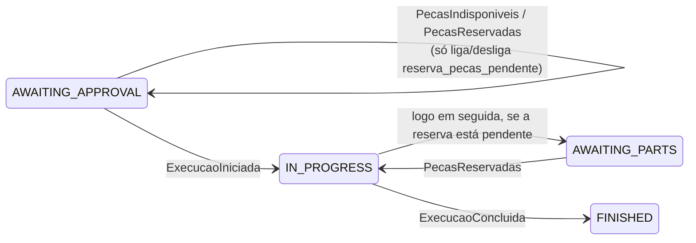

# Integração do OS Service com o Execução e Produção (Feature #334)

> Descreve como o OS Service (este repositório) se relaciona com o serviço de
> Execução e Produção depois que as rotas do mecânico `assumir`, `analisar` e
> `finalizar-execucao` saíram daqui (Feature #334, Epic #333). O fluxo
> distribuído e a divisão de responsabilidades são os de
> [`saga-flow.md`](./saga-flow.md) §2 (fonte única) e de
> [ADR-0017](../adr/0017-divisao-microsservicos-ownership-dados.md); o contrato
> dos eventos está em [`event-catalog.md`](./event-catalog.md) e na
> [ADR-0018](../adr/0018-mensageria-contratos-eventos.md). Este documento só
> registra o que o **código do OS Service** faz hoje: rotas, consumidores,
> guardas, idempotência e o comportamento transitório.

## 1. Rotas do mecânico

| Rota (OS Service) | Situação | Onde passa a viver |
|---|---|---|
| `PATCH /api/v1/ordens-servico/:id/assumir` | removida | `PATCH /api/v1/execucoes/{id}/iniciar-diagnostico` (Execução) |
| `PATCH /api/v1/ordens-servico/:id/analisar` | removida | mesma rota `iniciar-diagnostico`; sem contrapartida no OS |
| `PATCH /api/v1/ordens-servico/:id/finalizar-execucao` | removida | `PATCH /api/v1/execucoes/{id}/concluir` (Execução) |
| `PATCH /api/v1/ordens-servico/:id/servicos-insumos` | **mantida** | continua no OS Service (depende de `Servico` e `Peca`) |

`servicos-insumos` mudou em dois pontos: exige a OS em `UNDER_DIAGNOSIS`
(`400` se `DiagnosticoIniciado` ainda não foi processado; o mecânico repete) e
responde `200` com os **totais calculados**, não mais com o `Orcamento`:

```json
{
  "ordemServicoId": "3fa85f64-5717-4562-b3fc-2c963f66afa6",
  "valorTotalServicos": 450,
  "valorTotalPecas": 320.5,
  "valorTotalGeral": 770.5
}
```

O orçamento passa a ser consultado no Billing
(`GET /api/v1/orcamentos/{ordemServicoId}`). Os totais são calculados com
`Decimal` (`OrcamentoVo`) e só convertidos para `number` na borda do evento e da
resposta, o mesmo formato do exemplo de `OrcamentoCalculado` na ADR-0018.
Valores negativos são rejeitados antes de qualquer gravação em `OsPeca`.

Os casos de uso `AssumirOrdemServicoUseCase`, `AnalisarVeiculoUseCase` e
`FinalizarExecucaoUseCase`, os guards de domínio `podeAssumir`,
`podeAnalisarVeiculo` e `podeFinalizar` e os eventos internos
`OrdemServicoAssumida`, `VeiculoAnalisado` e `ServicoConcluidoPeloMecanico`
foram removidos. `ServicosEInsumosListados` foi renomeado para
`OrcamentoCalculado` (agora com `valorTotalGeral`).

## 2. Eventos publicados pelo OS Service

| Evento | Quando | Consumidor |
|---|---|---|
| `OrdemServicoRecebida` | `POST /ordens-servico`, logo depois de `OrdemServicoCriada` | Execução e Produção (cria a `Execucao` na fila de diagnóstico) |
| `OrcamentoCalculado` | `servicos-insumos` bem-sucedido | Billing Service; hoje, `GerarOrcamentoHandler` (ver §5) |
| `EtapaDaSagaFalhou` (`etapa=reparo`) | `ExecucaoConcluida` com a OS em `AWAITING_PARTS` | só registro e alerta; sem compensação automática (ADR-0018) |

Enquanto não há produtor Kafka, os três saem pelo `EmissorEventos` in-process
([ADR-0009](../adr/0009-eventos-dominio-in-process.md)), com o mesmo nome do
evento de integração. `OrdemServicoRecebida` e `EtapaDaSagaFalhou` ainda não
têm ouvinte in-process: esperam o publicador de integração. O payload de
`EtapaDaSagaFalhou` segue a ADR-0018 (`servicoOrigem`, `eventTypeOriginal`,
`ordemServicoId`, `etapa`, `motivo`).

## 3. Eventos do Execução consumidos pelo OS Service

| Evento | Handler | Guarda | Efeito | Se a guarda falhar |
|---|---|---|---|---|
| `DiagnosticoIniciado` | `AtualizarStatusEmDiagnosticoHandler` | OS em `RECEIVED` | grava `UNDER_DIAGNOSIS`, emite `OrdemServicoEmDiagnostico` (notifica o cliente) | ack, log informativo (reentrega ou OS já além) |
| `ExecucaoIniciada` | `AtualizarStatusExecucaoIniciadaHandler` | OS em `AWAITING_APPROVAL` | grava `IN_PROGRESS` e emite `OrdemServicoEmExecucao` (marca `iniciada_em`); se `reserva_pecas_pendente`, grava em seguida `AWAITING_PARTS` | ack; log informativo se a OS já está em `IN_PROGRESS`, `AWAITING_PARTS`, `FINISHED`, `DELIVERED` ou `CLOSED_WITHOUT_EXECUTION`, `warn` se está em `RECEIVED` ou `UNDER_DIAGNOSIS` |
| `ExecucaoConcluida` | `AtualizarStatusFinalizadaHandler` | OS em `IN_PROGRESS` | grava `FINISHED` e emite `OrdemServicoFinalizada` (tempo médio e notificação de conclusão seguem como estavam) | em `AWAITING_PARTS`: registra o motivo em `HistoricoStatusOS` e emite `EtapaDaSagaFalhou` (`reparo`); em `FINISHED`/`DELIVERED`: ack, log informativo; nos demais: ack, `warn` |

Nenhum desses consumidores lança exceção por estado inesperado: o evento é
reconhecido (ack) e fica registrado em log, para não gerar retry inútil quando o
transporte for Kafka. Eventos repetidos são, portanto, idempotentes.

## 4. A reserva de peças deixou de mudar o status

Pela [`saga-flow.md`](./saga-flow.md) §2, a OS só vai a `IN_PROGRESS` quando o
mecânico inicia o reparo (`ExecucaoIniciada`). Por isso:

- `PecasIndisponiveis` (`AtualizarStatusAguardandoPecasHandler`) só liga
  `OrdemServico.reserva_pecas_pendente`, e apenas com a OS em
  `AWAITING_APPROVAL`.
- `PecasReservadas` (`AtualizarStatusEmExecucaoHandler`): com a OS em
  `AWAITING_APPROVAL`, apenas desliga a pendência; com a OS em
  `AWAITING_PARTS`, volta a `IN_PROGRESS` (desliga a pendência e emite
  `OrdemServicoEmExecucao`). `OsSemPecasConfirmada` deixou de ter ouvinte.
- `OrdemServicoBacklogAdapter.findAllAguardandoPecas` passou a devolver também
  as OS em `AWAITING_APPROVAL` com `reserva_pecas_pendente = true`: elas ainda
  não receberam `ExecucaoIniciada`, mas já esperam peça e precisam ser
  liberadas quando o estoque chegar.



Não existe `AWAITING_APPROVAL → AWAITING_PARTS` direto e nenhum guard de
transição mudou. A coluna é necessária porque a pendência precisa sobreviver
entre `PecasIndisponiveis` (na aprovação do orçamento) e `ExecucaoIniciada`
(depois do pagamento e da ação do mecânico), possivelmente em processos
diferentes. A coluna é aditiva: `BOOLEAN NOT NULL DEFAULT false`, migration
`20261027120000_os_reserva_pecas_pendente`.

## 5. Comportamento transitório e janela de corte

- **Nada emite os eventos do Execução enquanto o serviço não existe.** Sem
  `DiagnosticoIniciado`, a OS fica em `RECEIVED`; sem `ExecucaoIniciada`, a OS
  aprovada fica em `AWAITING_APPROVAL`; sem `ExecucaoConcluida`, não chega a
  `FINISHED`. O monólito sozinho não percorre mais o fluxo do mecânico: o
  teste e2e (`test/ordem-servico.e2e-spec.ts`) injeta os três eventos pelo
  `EventEmitter2`.
- **`GerarOrcamentoHandler` continua**, agora ouvindo `OrcamentoCalculado`: faz
  in-process o papel do Billing (persiste o `Orcamento` e emite
  `OrcamentoGerado`). Deve ser removido junto com o corte do `Orcamento` para o
  Billing, para não haver dois criadores de orçamento.
- **Ordem de corte** (issue #334): remover as rotas só depois de o Execução ter
  as rotas equivalentes de pé em HML. O PR de remoção é o mesmo que religa os
  handlers aos eventos de integração.

## 6. Limitações conhecidas

- **Histórico por transição.** `OrdemServicoRepository.update` ainda não grava
  `HistoricoStatusOS` (Feature #335). Hoje só o caminho de falha
  `ExecucaoConcluida` em `AWAITING_PARTS` grava uma linha (com
  `statusAnterior = statusNovo`, porque não há transição).
- **Duas gravações não atômicas.** `IN_PROGRESS → AWAITING_PARTS` são duas
  chamadas a `update`. Se a segunda falhar, a OS fica em `IN_PROGRESS` com
  `reserva_pecas_pendente = true`, e a reentrega de `ExecucaoIniciada` é
  ignorada (a OS já não está em `AWAITING_APPROVAL`). O consumidor Kafka terá de
  tornar esse passo retomável ou a transição virar uma única transação.
- **`iniciada_em` na retomada.** Ao voltar de `AWAITING_PARTS` para `IN_PROGRESS`,
  `OrdemServicoEmExecucao` reinicia `iniciada_em` (comportamento já existente do
  `IniciarMonitoramentoTempoHandler`): o tempo médio exclui a espera por peça.
- **`PecasIndisponiveis` tardio.** Se chegar com a OS já fora de
  `AWAITING_APPROVAL`, é ignorado com `warn` (como antes da Feature).
