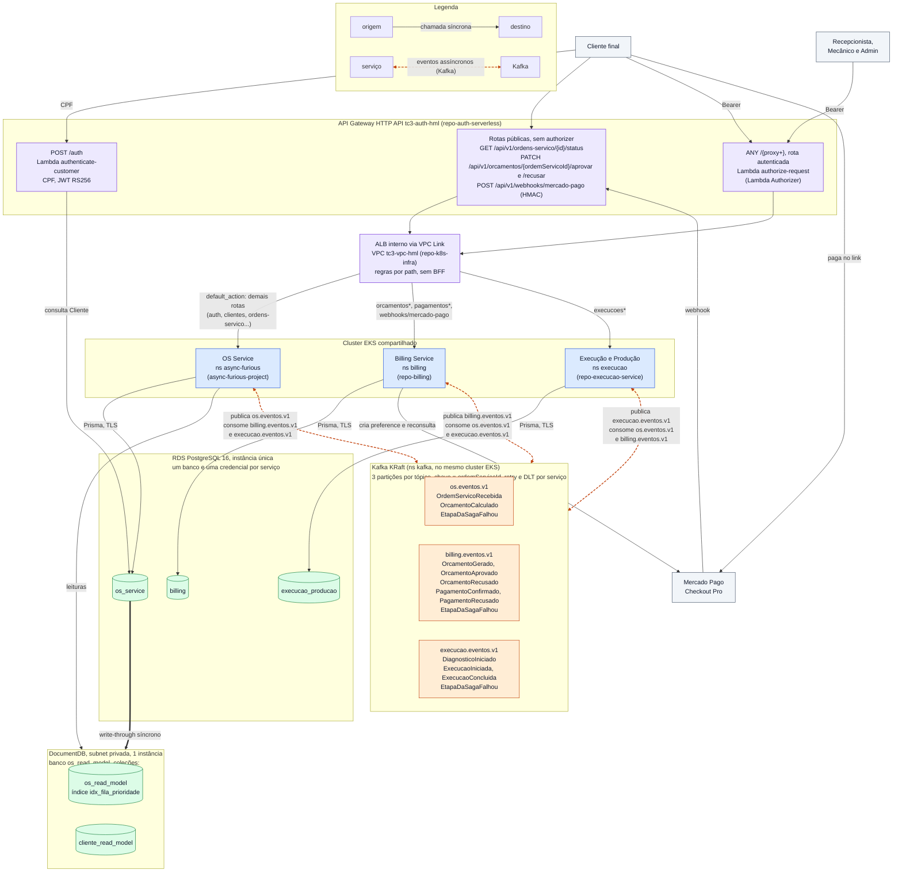

# Visão Geral da Arquitetura — Async & Furious (Fase 4)

> **Versão preliminar (02/11/2026)**, derivada das ADRs do épico de
> arquitetura ([#306](https://github.com/Async-And-Furious/async-furious-project/issues/306))
> e já considerando as mudanças em curso (rotas do mecânico migrando para o
> Execução e Produção, #334; Mercado Pago no Billing, #325). A revisão de
> fechamento acontece depois que o épico de Saga encerrar (08/11/2026). Feature
> [#348](https://github.com/Async-And-Furious/async-furious-project/issues/348).
>
> Este é o **diagrama-mestre único** da topologia-alvo (visão lógica): o
> `README.md` raiz aponta para cá, sem cópia. A borda e a implantação são
> detalhadas em [`edge-topology.md`](./edge-topology.md) e
> [`deployment-diagram.md`](./deployment-diagram.md). O fluxo transacional da
> Saga **não** está neste desenho (de propósito: misturar topologia e fluxo
> deixa os dois ilegíveis); ele está em [`saga-flow.md`](./saga-flow.md) §1.

## 1. Diagrama-mestre

Imagem para o PDF da entrega: [`arquitetura-alvo-fase4.png`](../static/arquitetura-alvo-fase4.png)
(retrato, próprio para página A4; gerada a partir do bloco Mermaid abaixo, sem
redesenho à mão; ver [Como regenerar o PNG](#8-como-regenerar-o-png)).



**Legenda.** Seta contínua é **chamada síncrona** (HTTP, SQL, driver); seta
tracejada laranja de duas pontas é o **evento assíncrono** no Kafka: o serviço
publica no seu tópico e consome os tópicos citados no rótulo da seta; a seta
grossa `os_service → DocumentDB` é o *write-through síncrono* do OS Service
(grava no PostgreSQL e, logo após o commit, atualiza o documento no DocumentDB
dentro do mesmo request).

**Observabilidade (fora do desenho).** APM, logs, métricas do cluster, traces e
alertas dos três serviços vão para a New Relic, e Lambdas e RDS ficam no
CloudWatch ([ADR-0005](../adr/0005-observabilidade.md),
[`observability.md`](../infrastructure/observability.md)); a telemetria não
entra no diagrama para mantê-lo legível, e aparece na implantação
([`deployment-diagram.md`](./deployment-diagram.md)).

Notas de leitura do desenho:

- **Ambiente.** A Fase 4 é HML-only ([`edge-topology.md`](./edge-topology.md) §5).
- **Sem BFF e sem chamada REST entre serviços.** O API Gateway fala com o ALB, e
  o ALB com cada serviço, por `path_pattern` de recurso
  ([ADR-0021](../adr/0021-borda-sem-bff.md)); toda coordenação entre serviços é
  por evento. Autenticação, rotas públicas e migração das rotas do mecânico:
  [`edge-topology.md`](./edge-topology.md) §2 e §3.
- **Rota pública do webhook.** `POST /api/v1/webhooks/mercado-pago` não passa
  pelo authorizer (o provedor não apresenta o nosso JWT); a proteção é a
  assinatura HMAC `x-signature` mais a reconsulta do pagamento
  ([ADR-0022](../adr/0022-integracao-mercado-pago-checkout-pro.md)). O mesmo vale
  para status e aprovação/recusa de orçamento
  ([ADR-0011](../adr/0011-aprovacao-orcamento-api-publica.md)).
- **Mercado Pago.** O Billing cria a preference (Checkout Pro) na aprovação do
  orçamento e reconsulta o pagamento quando o webhook chega; o cliente paga na
  página hospedada do Mercado Pago, fora do nosso sistema.

## 2. Os serviços e os dados

| Serviço | Repositório | Banco (dono) | Publica | Consome |
|---|---|---|---|---|
| **OS Service** | `async-furious-project` | PostgreSQL `os_service` (escrita) e DocumentDB `os_read_model` (leitura, CQRS) | `os.eventos.v1` | `billing.eventos.v1`, `execucao.eventos.v1` |
| **Billing Service** | `repo-billing` | PostgreSQL `billing` | `billing.eventos.v1` | `os.eventos.v1`, `execucao.eventos.v1` |
| **Execução e Produção** | `repo-execucao-service` | PostgreSQL `execucao_producao` | `execucao.eventos.v1` | `os.eventos.v1`, `billing.eventos.v1` |

- **Quais eventos cada serviço assina** (por tópico) está na tabela
  "Assinaturas por serviço" de [`event-catalog.md`](./event-catalog.md).
  Envelope, partição (`ordemServicoId`), retry e DLT:
  [ADR-0018](../adr/0018-mensageria-contratos-eventos.md).
- **PostgreSQL.** Uma única instância RDS 16 por ambiente, com um banco lógico e
  uma credencial por serviço, sem acesso cruzado
  ([ADR-0020](../adr/0020-bancos-compartilhados-isolamento-credencial.md)).
  Nenhuma FK cruza a fronteira de serviço.
- **DocumentDB.** Cluster em subnet privada, 1 instância, TLS obrigatório,
  exclusivo do OS Service: banco `os_read_model`, coleções `os_read_model` e
  `cliente_read_model` e o índice `idx_fila_prioridade` da fila ordenada
  ([ADR-0019](../adr/0019-documentdb-read-model-os-cliente.md),
  [`persistence-model.md`](./persistence-model.md)). Billing e Execução não usam
  NoSQL.
- **Cluster e banco compartilhados** são trade-off de custo acadêmico, com
  ponto único de falha aceito (ADR-0020).

## 3. A borda

Resumo; o mapa completo de rotas, o roteamento no ALB e as exceções públicas
estão em [`edge-topology.md`](./edge-topology.md) §2.

| Camada | O que faz |
|---|---|
| API Gateway HTTP API (`tc3-auth-hml`) | Único componente público. `POST /auth` vai direto à Lambda `authenticate-customer`; as rotas públicas (status, aprovar/recusar, webhook do Mercado Pago) não têm authorizer; todo o resto cai em `ANY /{proxy+}`, sob a Lambda Authorizer `authorize-request` |
| VPC Link e ALB interno | O Gateway entra na VPC pelo VPC Link; o ALB escolhe o serviço pelo path (`orcamentos*`, `pagamentos*`, `webhooks/mercado-pago` para o Billing; `execucoes*` para o Execução; o resto, `default_action`, para o OS Service) |
| Segredos | A chave privada RS256 fica no Secrets Manager (Lambda de autenticação) e a pública no SSM (Authorizer e serviços) |

## 4. Comunicação entre Bounded Contexts

Na Fase 4, a divisão em microsserviços ([ADR-0017](../adr/0017-divisao-microsservicos-ownership-dados.md))
substitui o monólito dos quatro Bounded Contexts (`cadastro`, `ordem-servico`,
`pecas-insumos`, `financeiro`) por três serviços. Duas regras de comunicação
valem:

- **Entre serviços**: só eventos de integração no Kafka, em Saga coreografada
  ([ADR-0016](../adr/0016-saga-coreografada.md), [`saga-flow.md`](./saga-flow.md)),
  com o catálogo em [`event-catalog.md`](./event-catalog.md).
- **Dentro do OS Service**: os Bounded Contexts `ordem-servico`, `cadastro` e
  `pecas-insumos` continuam se comunicando em processo, via
  `EmissorEventos`/`DomainEvent` ([ADR-0009](../adr/0009-eventos-dominio-in-process.md),
  [`docs/ddd.md`](../ddd.md) §5). O `financeiro` migra para o Billing.

O Bounded Context **Segurança e Autenticação** já tinha saído do monólito na
Fase 3 (Lambdas em `repo-auth-serverless`); o login de staff continua no OS
Service, e os demais serviços só validam o JWT. Ver
[`authentication-flow.md`](./authentication-flow.md) e a revisão do Context Map
em [`docs/domain/revisao-fase3.md`](../domain/revisao-fase3.md).

## 5. Os seis repositórios

| Repositório | Papel |
|---|---|
| `async-furious-project` | OS Service (reaproveitado do monólito) e repositório-mãe da documentação |
| `repo-billing` | Billing Service: orçamento, pagamento e integração com o Mercado Pago |
| `repo-execucao-service` | Execução e Produção: fila de execução, diagnóstico e reparo |
| `repo-auth-serverless` | Borda: API Gateway, Lambda de autenticação por CPF e Lambda Authorizer |
| `repo-k8s-infra` | VPC, EKS, ECR, ALB interno, Kafka (Helm, KRaft) e New Relic |
| `repo-db-infra` | RDS PostgreSQL (um banco e uma credencial por serviço) e DocumentDB |

O repositório `async-furious-front` (privado) não faz parte desta arquitetura.

> **Lacuna herdada da Fase 3**: as RFCs e os READMEs dos satélites citam um
> `HANDOFF.md` como lista mestra de decisões, que não foi encontrado em
> nenhuma branch. O racional verificável está em [`docs/rfcs/`](../rfcs/README.md).

## 6. Estado de implementação (28/10/2026, preliminar)

O diagrama mostra o **estado-alvo**. O que já existe no código hoje, por
componente, para o revisor não confundir desenho com entrega:

| Componente | Situação |
|---|---|
| OS Service | Ainda com os módulos e eventos in-process do monólito: sem produtor/consumidor Kafka, sem a coluna `pago_em` e sem o detector de OS parada. Read model em DocumentDB implementado na #335 (write-through síncrono no repository, fila por cursor, job de rebuild); validação contra o cluster real pendente em HML. As rotas do mecânico migram para o Execução na Feature #334 (em curso) |
| Billing Service | Orçamento, aprovação com Checkout Pro, webhook do Mercado Pago (HMAC e reconsulta), `GET /pagamentos/{ordemServicoId}` e estorno de pagamento atrasado ou duplicado implementados na #325, no PR repo-billing#1 (aberto, em revisão); publicação e consumo no Kafka, inclusive o handler de `EtapaDaSagaFalhou`, na Feature #326 (hoje os eventos só vão para o log) |
| Execução e Produção | Fila, ciclo da `Execucao` e as rotas `/api/v1/execucoes*` implementados na #320, no PR repo-execucao-service#2 (aberto); consumidores e publicação no Kafka ainda não (os marcos só vão para o log) |
| Borda (`repo-auth-serverless`) | Em `infra/hml/main.tf` do `develop` (PR #70, mergeado em 27/10): `POST /auth`, health público, rotas públicas de status, aprovação/recusa e webhook (`authorization_type = NONE`) e `ANY /{proxy+}` com authorizer `CUSTOM`, a da ADR-0021. Falta aplicar essa configuração em HML e validar (Feature #317); o desenho anterior (`ANY /api/v1/{proxy+}`, `/billing/{proxy+}`, `/execucao/{proxy+}`) não existe mais no código |
| `repo-k8s-infra` | ALB com regras por path e um target group por serviço, namespaces, ECR por serviço e Kafka com os tópicos `*.eventos.v1`, `*.retry.v1` e `*.dlt.v1` provisionados |
| `repo-db-infra` | RDS com os três bancos lógicos (credenciais por serviço) e DocumentDB provisionados |

## 7. Ambiente local

Fora da AWS (`pnpm run dev`, cluster `kind` via `scripts/local-up.sh`) não há
API Gateway nem Authorizer: a autenticação roda em `AUTH_MODE=local` (JWT HS256)
dentro do próprio serviço. Ver [`deployment-diagram.md`](./deployment-diagram.md) §1
e [`docs/infrastructure/kubernetes.md`](../infrastructure/kubernetes.md).

## 8. Como regenerar o PNG

O PNG é gerado do bloco Mermaid deste arquivo. Com Node e um Chromium
instalados:

```bash
cat > /tmp/puppeteer.json <<'JSON'
{ "executablePath": "/usr/bin/chromium", "args": ["--no-sandbox"] }
JSON
awk '/^```mermaid/{f=1;next} /^```/{f=0} f' docs/architecture/overview.md > /tmp/arquitetura-alvo.mmd
pnpm dlx @mermaid-js/mermaid-cli -p /tmp/puppeteer.json --size 4000 \
  -i /tmp/arquitetura-alvo.mmd -o docs/static/arquitetura-alvo-fase4.png -s 1 -b white
```

## 9. Documentos relacionados

- [Topologia de infraestrutura e borda](./edge-topology.md) — rotas, ALB, autenticação
- [Fluxo distribuído da OS — Saga coreografada](./saga-flow.md) — diagrama de sequência e matriz de compensação
- [Catálogo de eventos](./event-catalog.md) e [Fronteiras e ownership de dados](./service-boundaries.md)
- [Modelo de persistência](./persistence-model.md)
- [Diagrama de Implantação](./deployment-diagram.md)
- [Diagrama de Componentes detalhado](./component-diagram.md) (Fase 3, monólito)
- [Sequência de autenticação](./authentication-flow.md) e [de abertura de OS](./service-order-flow.md)
- [Infraestrutura AWS](../infrastructure/aws.md) e [API Gateway e Lambda](../infrastructure/api-gateway-lambda.md)
- [ADRs](../adr/README.md) e [RFCs](../rfcs/README.md)
